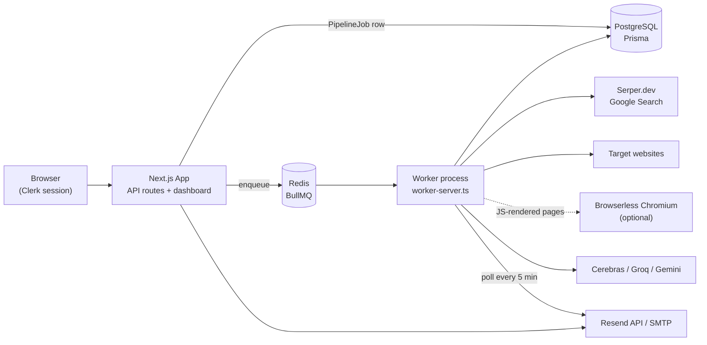
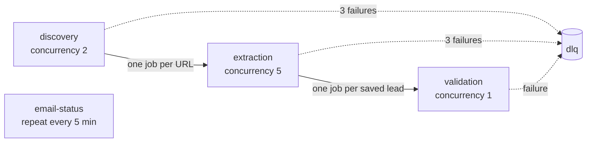
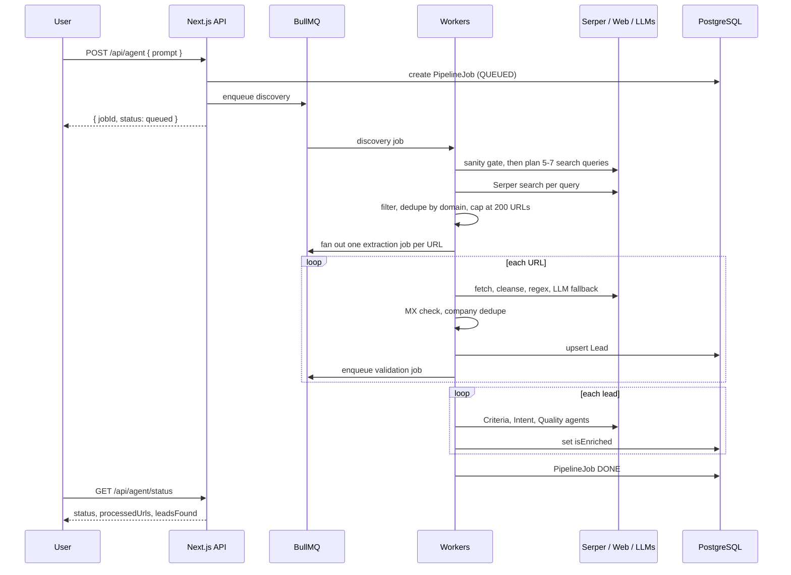
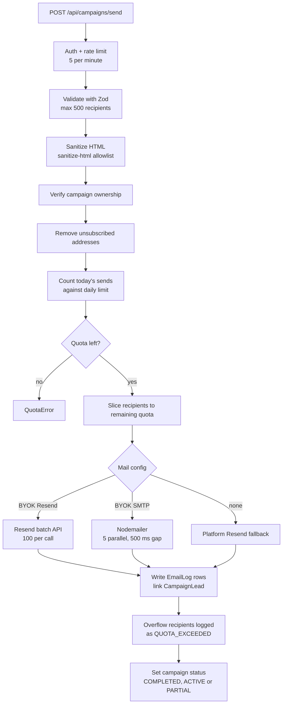
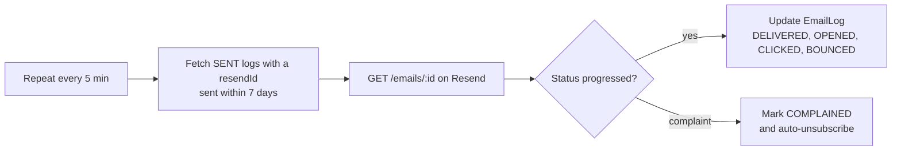

# HyperDrive AI

Autonomous lead generation and email outreach engine. Self-hosted, open source, MIT licensed.

       

---

## What It Is

HyperDrive AI turns one sentence into a verified pipeline of outreach-ready contacts. Describe an audience in plain English and an event-driven BullMQ and Redis pipeline plans the search, crawls the live web through Serper.dev, and strips each page down to its contact signal with Cheerio. A regex-first extractor resolves most pages with zero LLM tokens, and a Cerebras, Groq and Gemini cascade with per-key rotation handles the rest. Every lead then faces a three-agent consensus gate (Criteria, Intent, Quality) whose citations are string-matched against the source text to kill hallucinations, before it lands in a workspace-isolated PostgreSQL store. From there it runs campaigns with AI-written copy, BYOK Resend or SMTP dispatch behind AES-256-GCM encrypted credentials, quota-aware batching with automatic resume, and per-workspace unsubscribe enforcement. It does not resell a stale contact database like Apollo or Hunter. It reads the web as it is today.

---

## Table of Contents

1. [Features](#features)
2. [Architecture](#architecture)
3. [Workflows](#workflows)
4. [Multi-LLM and Security Design](#multi-llm-and-security-design)
5. [Tech Stack](#tech-stack)
6. [Project Structure](#project-structure)
7. [Database Schema](#database-schema)
8. [API Reference](#api-reference)
9. [Environment Variables](#environment-variables)
10. [Getting Started](#getting-started)
11. [Deployment](#deployment)
12. [Webhooks and Cron](#webhooks-and-cron)
13. [Troubleshooting](#troubleshooting)
14. [CI and Testing](#ci-and-testing)
15. [Contributing](#contributing)
16. [Compliance and Responsible Use](#compliance-and-responsible-use)
17. [License](#license)

---

## Features

- **Autonomous lead agent.** Natural language prompt, then Serper.dev search, URL filtering, Cheerio scrape, regex extraction (LLM skipped when emails are found), LLM fallback chain, PostgreSQL upsert.
- **Multi-LLM key rotation.** Cerebras (primary), Groq (secondary) and Gemini (final fallback), with per-key exponential backoff and rotation on HTTP 429.
- **Three-agent validation.** Criteria, Intent and Quality agents vote on each lead. Every citation must appear verbatim in the source text.
- **Campaign management.** CRUD with soft delete, pagination and `DRAFT`, `ACTIVE`, `COMPLETED`, `PAUSED`, `PARTIAL` statuses.
- **Dual email dispatch.** Bring your own Resend key or SMTP credentials, with a platform Resend fallback. Resend uses the batch API (100 per call). SMTP runs 5 parallel connections with a 500 ms pause between chunks.
- **Encrypted credentials.** BYOK SMTP passwords and Resend keys are encrypted at rest with AES-256-GCM.
- **Workspace isolation.** Leads, campaigns and email logs are scoped per workspace.
- **Unsubscribe enforcement.** Opt-outs are stored per workspace and filtered before every send.
- **Daily quota enforcement.** Tracked through the `QUOTA_EXCEEDED` email log status, with a cron endpoint that resumes partial campaigns.
- **Polling-based email tracking.** A BullMQ repeatable job polls the Resend API every 5 minutes. No public URL is required, so it works on localhost.
- **Optional webhooks.** Clerk (user provisioning) and Resend (delivery events) for public deployments.
- **Dual rate limiting.** Upstash Redis sliding window on the agent route, in-memory limiter on other routes.
- **Health endpoint.** `/api/health` with live dependency checks for container orchestration.
- **WebGL landing page.** Three.js particle hero, Framer Motion, GSAP and Lenis smooth scroll.

---

## Architecture

HyperDrive AI is a Next.js application plus a standalone BullMQ worker process. The two share PostgreSQL and Redis but are otherwise decoupled, so either can restart or scale without affecting the other.



### Queue Topology

Each stage is its own BullMQ queue, so stages scale and fail independently. Jobs retry 3 times with exponential backoff (5 s, 25 s, 125 s). Jobs that exhaust retries are copied to the dead-letter queue.



| Queue          | Input                         | Output                                   | Concurrency |
| -------------- | ----------------------------- | ---------------------------------------- | ----------- |
| `discovery`    | Prompt                        | Up to 200 unique target URLs             | 2           |
| `extraction`   | URL and target criteria       | Upserted leads, one validation job each  | 5           |
| `validation`   | Lead ID and filtered page text | `isEnriched` flag on the lead           | 1           |
| `email-status` | Heartbeat                     | Updated `EmailLog` statuses              | 1           |
| `dlq`          | Permanently failed jobs       | Inspection and replay                    | n/a         |

Validation runs one job at a time with a 3 second cooldown to stay inside LLM token quotas.

### Runtime Components

| Component    | Responsibility                                                                                   |
| ------------ | ------------------------------------------------------------------------------------------------ |
| `app`        | Next.js server: auth (Clerk), REST API, dashboard, campaign sending, cron endpoint               |
| `worker`     | Discovery, extraction, validation and email-status workers in one long-lived process             |
| `postgres`   | Source of truth for users, workspaces, leads, campaigns, email logs, pipeline jobs               |
| `redis`      | BullMQ broker with AOF persistence so queued jobs survive restarts; also holds the Serper circuit breaker state |
| `migrate`    | Short-lived container that runs `prisma db push` before app and worker start                     |
| `browserless`| Optional headless Chromium for JavaScript-rendered pages                                         |

### Resilience Mechanisms

- **Serper circuit breaker.** Three consecutive failures open the circuit for 5 minutes, tracked in Redis, so a provider outage does not burn retries.
- **Atomic completion.** A `PipelineJob` moves to `DONE` through a single compare-and-swap SQL `UPDATE`, gated on `pendingValidations <= 0` and `processedUrls >= totalUrls`. Concurrent workers cannot double-write the transition.
- **No stuck jobs.** A permanently failed extraction still counts its URL as processed, and a permanently failed validation still decrements the pending counter.
- **Fail-open validation.** If every LLM provider is rate limited, the lead is skipped and left unenriched. It is never rejected for an infrastructure reason.
- **Graceful shutdown.** The worker closes all four workers on `SIGTERM` and `SIGINT`.

---

## Workflows

### 1. Lead Generation

`POST /api/agent` creates a `PipelineJob`, enqueues a discovery job and returns a `jobId` immediately. Clients poll `GET /api/agent/status?jobId=` for progress.



**Discovery worker**

1. A pre-flight sanity gate asks an LLM whether the prompt describes a real business type. Fictional or nonsensical prompts fail fast without spending search quota. If the LLM itself errors, the prompt is allowed through.
2. The orchestrator turns the prompt into 5 to 7 natural search queries plus a `targetCriteria` string naming the data points to extract.
3. Each query runs through Serper.dev (up to 100 results). URLs pass through block lists covering aggregators, social media, job boards, freelance marketplaces, training sites, CDNs and asset files.
4. URLs are deduplicated by root domain, keeping the most contact-like path (`/contact`, then `/about`, `/team`, and so on). The list is capped at 200.

**Extraction worker**

1. **Fetch** the HTML with a 5 second timeout. If the page is JavaScript-rendered and Browserless is configured, retry through headless Chromium.
2. **Cleanse** with Cheerio, removing scripts, navigation, footers, modals and cookie banners.
3. **Convert** to Markdown with `node-html-markdown` and keep only contact-relevant segments.
4. **Regex first.** Emails (including Cloudflare-obfuscated ones) are extracted by regex. If any are found, the LLM is skipped and no tokens are spent.
5. **LLM fallback.** Only when regex finds nothing does the Cerebras, Groq, Gemini cascade run.
6. **Gate and persist.** Each email passes an MX and disposable-domain check, then fuzzy company deduplication, then upserts on `(workspaceId, email)`.

**Validation worker**

Three agents run sequentially to avoid tripling quota use:

| Agent    | Role                                                                | Effect                  |
| -------- | ------------------------------------------------------------------- | ----------------------- |
| Criteria | Does the company match the stated target criteria?                  | Gate                    |
| Quality  | Any red flags such as shutdown, acquisition or a zombie site?       | Gate                    |
| Intent   | Buying signals such as hiring, funding, launches                    | +0.15 score bonus only  |

Each agent must return a verbatim quote. A citation that is not found in the source text is forced to `false`, which is the anti-hallucination guard. A lead is approved when Criteria passes and Quality passes (or Quality failed to run).

### 2. Campaign Send



### 3. Quota Resume

A scheduled `GET /api/cron/resume-campaigns` (Bearer `CRON_SECRET`) finds campaigns in `PARTIAL` status, re-checks each owner's remaining quota, drops anyone who unsubscribed since the original send, sends the stored `QUOTA_EXCEEDED` messages, and updates the log statuses.

### 4. Email Status Tracking



Where a public URL is available, the optional Resend webhook delivers the same updates in real time instead.

### 5. User Provisioning

On the first authenticated API call, `getOrCreateWorkspace()` creates the `User` and `Workspace` rows just in time, so no Clerk webhook is needed locally. The optional Clerk webhook adds real-time lifecycle sync on public deployments.

---

## Multi-LLM and Security Design

### KeyRotationLLMClient

| Tier      | Provider | Model                    |
| --------- | -------- | ------------------------ |
| Primary   | Cerebras | `gpt-oss-120b`           |
| Secondary | Groq     | `llama-3.3-70b-versatile`|
| Fallback  | Gemini   | `gemini-2.5-flash-lite`  |

- Per-key exponential backoff (1 s, 2 s, 4 s) on HTTP 429.
- Comma-separated key pools through `CEREBRAS_API_KEYS`, `GROQ_API_KEYS` and `GEMINI_API_KEYS`.
- Gemini returns `null` on exhaustion instead of throwing, so callers can degrade gracefully.

### Security

- **BYOK encryption.** SMTP passwords and Resend API keys are encrypted at rest with AES-256-GCM using `ENCRYPTION_KEY`.
- **Secret masking.** Secrets are returned masked on `GET`. Submitting the mask is a no-op that preserves the stored value, and submitting an empty string clears it.
- **Authentication.** Clerk middleware protects every route that is not explicitly public.
- **Input handling.** Zod validates API inputs. Outgoing email HTML is sanitized against an allowlist and limited to `https` and `mailto` schemes.
- **Headers.** `next.config.mjs` sets `X-Frame-Options: DENY`, HSTS, `X-Content-Type-Options`, Referrer-Policy and Permissions-Policy.
- **Container.** The Docker image runs as a non-root user, and Postgres and Redis ports are not exposed to the host.

---

## Tech Stack

| Layer            | Technology                                                                 |
| ---------------- | -------------------------------------------------------------------------- |
| Framework        | Next.js 15 (App Router), React 19, TypeScript 5, Tailwind CSS 3.4          |
| Visuals          | Three.js, React Three Fiber, drei, Framer Motion, GSAP, Lenis              |
| Database         | PostgreSQL 16 via Prisma 7 with the `@prisma/adapter-pg` driver adapter    |
| Queue            | BullMQ on Redis (ioredis)                                                  |
| Auth             | Clerk, with Svix for webhook signature verification                        |
| LLMs             | Cerebras, Groq (raw HTTP), Google Gemini (`@google/genai`)                 |
| Search           | Serper.dev                                                                 |
| Scraping         | Cheerio, `node-html-markdown`, optional Browserless Chromium               |
| Email            | Resend, Nodemailer (SMTP)                                                  |
| Validation       | Zod, `sanitize-html`                                                       |
| Rate limiting    | `@upstash/ratelimit` with `@upstash/redis`, plus an in-memory limiter      |
| Testing          | Vitest, Playwright                                                         |

---

## Project Structure

```text
hyperdrive-ai/
├── src/
│   ├── app/
│   │   ├── api/
│   │   │   ├── agent/                # Lead generation entry point and status
│   │   │   ├── ai/generate/          # AI email copy generation
│   │   │   ├── analytics/            # Email and campaign analytics
│   │   │   ├── campaigns/            # Campaign CRUD, [id], and batch send
│   │   │   ├── cron/resume-campaigns/# Resume PARTIAL campaigns
│   │   │   ├── health/               # Dependency health check
│   │   │   ├── leads/                # Leads CRUD (paginated, searchable)
│   │   │   ├── settings/             # Settings and configuration check
│   │   │   ├── stats/                # Live statistics
│   │   │   ├── unsubscribe/          # Public opt-out handler
│   │   │   ├── webhook/clerk/        # Clerk user provisioning
│   │   │   └── webhooks/resend/      # Resend delivery events
│   │   ├── dashboard/                # Overview, campaigns, analytics, settings
│   │   ├── docs/ privacy/ terms/     # Public pages
│   │   ├── sign-in/ sign-up/         # Clerk auth pages
│   │   └── page.tsx                  # Landing page
│   ├── components/
│   │   ├── canvas/HeroScene.tsx      # Three.js particle hero
│   │   ├── providers/SmoothScroll.tsx
│   │   └── ErrorBoundary.tsx
│   ├── lib/
│   │   ├── agent/orchestrator.ts     # Prompt to search plan
│   │   ├── ai/rotation-client.ts     # Cerebras, Groq, Gemini with key rotation
│   │   ├── mail/                     # Dispatcher (Resend and SMTP), quota limits
│   │   ├── queue/
│   │   │   ├── workers/              # discovery, extraction, validation, email-status
│   │   │   ├── index.ts              # Queue definitions and Redis connection
│   │   │   ├── pipeline.ts           # startPipelineJob()
│   │   │   └── worker-server.ts      # Standalone worker entry point
│   │   ├── scraper/                  # search, extractor, filter, regex, email validator, deduplicator
│   │   ├── api-handler.ts            # Error-mapping wrapper for routes
│   │   ├── env.ts errors.ts logger.ts prisma.ts
│   │   ├── rate-limit.ts             # Upstash and in-memory limiters
│   │   ├── security.ts               # AES-256-GCM helpers
│   │   └── workspace.ts              # getOrCreateWorkspace()
│   └── middleware.ts                 # Clerk route protection
├── prisma/                           # schema.prisma and migrations
├── e2e/                              # Playwright specs
├── docs/ARCHITECTURE.md              # Extended architecture notes
├── .github/workflows/ci.yml          # Lint, build, unit tests
├── Dockerfile                        # Multi-stage build, non-root runtime
├── Dockerfile.worker                 # Worker image
├── docker-compose.yml                # Full self-contained stack
└── .env.example
```

---

## Database Schema

```text
User ──< Workspace ──< Campaign ──< EmailLog
                  ──< Lead ──< CampaignLead >── Campaign
                  ──< Unsubscribe
                  ──< PipelineJob ──< Lead
```

| Model          | Key Fields                                                                                                                                      |
| -------------- | ----------------------------------------------------------------------------------------------------------------------------------------------- |
| `User`         | `clerkId` (unique), `email` (unique), `smtpHost`, `smtpPort`, `smtpUser`, `smtpPassword` (encrypted), `resendApiKey` (encrypted), `senderEmail`, `senderName` |
| `Workspace`    | `name`, `description`, `userId`                                                                                                                 |
| `Lead`         | `email`, `companyName`, `prospectName`, `phone`, `role`, `scrapedFromUrl`, `isEnriched`, `workspaceId`, `pipelineJobId`. Unique on `(workspaceId, email)` |
| `Campaign`     | `name`, `goal`, `targetAudience`, `status`, `workspaceId`, `deletedAt` (soft delete)                                                            |
| `CampaignLead` | `campaignId`, `leadId`. Unique on `(campaignId, leadId)`                                                                                        |
| `EmailLog`     | `campaignId`, `leadId`, `recipient`, `subject`, `content`, `status`, `resendId` (unique), `smtpMessageId` (unique), `sentAt`                    |
| `Unsubscribe`  | `workspaceId`, `email`, `reason`. Unique on `(workspaceId, email)`                                                                              |
| `PipelineJob`  | `workspaceId`, `prompt`, `status`, `totalUrls`, `processedUrls`, `leadsFound`, `pendingValidations`, `errorMessage`                             |

**Enums**

- `CampaignStatus`: `DRAFT`, `ACTIVE`, `COMPLETED`, `PAUSED`, `PARTIAL`
- `PipelineJobStatus`: `QUEUED`, `RUNNING`, `DONE`, `FAILED`
- `EmailStatus`: `PENDING`, `SENT`, `DELIVERED`, `OPENED`, `CLICKED`, `FAILED`, `BOUNCED`, `COMPLAINED`, `QUOTA_EXCEEDED`

**Indexes**

- `Campaign(workspaceId, createdAt DESC)`
- `Lead(workspaceId, createdAt DESC)`, `Lead(pipelineJobId)`
- `EmailLog(campaignId, status)`, `EmailLog(campaignId, createdAt DESC)`, `EmailLog(leadId)`
- `CampaignLead(campaignId)`, `CampaignLead(leadId)`
- `Unsubscribe(workspaceId, email)`
- `PipelineJob(workspaceId, createdAt DESC)`

---

## API Reference

### Lead Generation

| Method | Endpoint             | Description                                  |
| ------ | -------------------- | -------------------------------------------- |
| `POST` | `/api/agent`         | Enqueue a lead generation pipeline job       |
| `GET`  | `/api/agent/status`  | Poll job progress with `?jobId=<jobId>`      |

Auth: Clerk required. Rate limit: 5 requests per minute (Upstash sliding window).

```json
// POST /api/agent
{ "prompt": "Find digital marketing agencies in New York" }

// Response (non-blocking)
{ "jobId": "uuid", "status": "queued" }

// GET /api/agent/status?jobId=<jobId>
{ "status": "RUNNING", "processedUrls": 42, "totalUrls": 120, "leadsFound": 17 }
```

Status progression: `QUEUED`, `RUNNING`, then `DONE` or `FAILED`.

### Leads

| Method   | Endpoint               | Description                                          |
| -------- | ---------------------- | ---------------------------------------------------- |
| `GET`    | `/api/leads`           | List leads (paginated, search by email, company, name) |
| `POST`   | `/api/leads`           | Create a lead (upsert)                               |
| `PATCH`  | `/api/leads?id=<id>`   | Update lead fields                                   |
| `DELETE` | `/api/leads?id=<id>`   | Delete a lead                                        |

### Campaigns

| Method   | Endpoint                   | Description                           |
| -------- | -------------------------- | ------------------------------------- |
| `GET`    | `/api/campaigns`           | List campaigns (paginated)            |
| `GET`    | `/api/campaigns/[id]`      | Campaign details and email logs       |
| `POST`   | `/api/campaigns`           | Create a campaign                     |
| `PATCH`  | `/api/campaigns`           | Update campaign fields or status      |
| `DELETE` | `/api/campaigns?id=<id>`   | Soft delete a campaign                |
| `POST`   | `/api/campaigns/send`      | Batch send emails for a campaign      |

```json
// POST /api/campaigns/send
{
  "campaignId": "uuid",
  "recipients": ["alice@example.com", "bob@example.com"],
  "subject": "quick question",
  "content": "Email body text..."
}
```

- Maximum 500 recipients per request.
- Unsubscribed addresses are removed before sending.
- Recipients beyond the daily quota are logged as `QUOTA_EXCEEDED` and the campaign becomes `PARTIAL`.

### AI Email Generation

| Method | Endpoint            | Description                 |
| ------ | ------------------- | --------------------------- |
| `POST` | `/api/ai/generate`  | Generate AI cold email copy |

Body: `{ "prompt": "...", "goal": "Lead Gen", "productName": "...", "model": "llama-3.3-70b-versatile" }`

### Settings

| Method | Endpoint               | Description                                                    |
| ------ | ---------------------- | -------------------------------------------------------------- |
| `GET`  | `/api/settings`        | Load settings, with secrets masked                             |
| `POST` | `/api/settings`        | Save settings (masked value means no change, empty clears)     |
| `GET`  | `/api/settings/check`  | Report configuration flags for database, APIs and webhooks     |

### Analytics and Stats

| Method | Endpoint           | Description                                      |
| ------ | ------------------ | ------------------------------------------------ |
| `GET`  | `/api/stats`       | Live campaign and email metrics                  |
| `GET`  | `/api/analytics`   | Email event analytics grouped by date            |

### Compliance, Webhooks, Cron and Health

| Method | Endpoint                       | Description                                                        |
| ------ | ------------------------------ | ------------------------------------------------------------------ |
| `POST` | `/api/unsubscribe`             | Record an opt-out (public, no auth)                                |
| `POST` | `/api/webhook/clerk`           | Clerk lifecycle events (`user.created` provisions User and Workspace) |
| `POST` | `/api/webhooks/resend`         | Resend tracking events (updates `EmailLog` status)                 |
| `GET`  | `/api/cron/resume-campaigns`   | Resume `PARTIAL` campaigns (requires `CRON_SECRET`)                |
| `GET`  | `/api/health`                  | Dependency health check                                            |

---

## Environment Variables

Copy `.env.example` to `.env.local` (local development) or `.env` (Docker) and fill in the values.

| Variable                                | Requirement      | Description                                                                                                  |
| --------------------------------------- | ---------------- | ------------------------------------------------------------------------------------------------------------ |
| `DATABASE_URL`                          | Required         | PostgreSQL connection string                                                                                 |
| `REDIS_URL`                             | Required         | Redis URL for BullMQ, for example `redis://localhost:6379`                                                   |
| `NEXT_PUBLIC_CLERK_PUBLISHABLE_KEY`     | Required         | Clerk public key                                                                                             |
| `CLERK_PUBLISHABLE_KEY`                 | Required         | Clerk publishable key                                                                                        |
| `CLERK_SECRET_KEY`                      | Required         | Clerk secret key                                                                                             |
| `NEXT_PUBLIC_CLERK_SIGN_IN_URL`         | Required         | Sign-in path, for example `/sign-in`                                                                         |
| `NEXT_PUBLIC_CLERK_SIGN_UP_URL`         | Required         | Sign-up path, for example `/sign-up`                                                                         |
| `NEXT_PUBLIC_CLERK_AFTER_SIGN_IN_URL`   | Required         | Post sign-in redirect, for example `/dashboard`                                                              |
| `NEXT_PUBLIC_CLERK_AFTER_SIGN_UP_URL`   | Required         | Post sign-up redirect, for example `/dashboard`                                                              |
| `SERPER_API_KEY`                        | Required         | Serper.dev Google Search key. The agent does not run without it                                              |
| `GROQ_API_KEY`                          | Required         | Groq key, also used for AI email generation                                                                  |
| `ENCRYPTION_KEY`                        | Required         | 64-character hex string for AES-256-GCM                                                                      |
| `CRON_SECRET`                           | Required         | Authenticates `/api/cron/*` endpoints                                                                        |
| `NEXT_PUBLIC_APP_URL`                   | Required         | Public URL (SEO, Open Graph, sitemap)                                                                        |
| `RESEND_API_KEY`                        | Optional         | Platform-level fallback sender. Also enables email status polling                                            |
| `RESEND_FROM_EMAIL`                     | Optional         | Verified sender address on a domain verified in Resend                                                       |
| `CEREBRAS_API_KEY`                      | Optional         | Fast, free-tier extraction LLM                                                                               |
| `CEREBRAS_API_KEYS`                     | Optional         | Comma-separated pool for key rotation                                                                        |
| `GROQ_API_KEYS`                         | Optional         | Comma-separated pool for key rotation                                                                        |
| `GEMINI_API_KEY`                        | Optional         | Final LLM fallback                                                                                           |
| `GEMINI_API_KEYS`                       | Optional         | Comma-separated pool for key rotation                                                                        |
| `UPSTASH_REDIS_REST_URL`                | Optional         | Distributed rate limiting for the agent route                                                                |
| `UPSTASH_REDIS_REST_TOKEN`              | Optional         | Upstash Redis auth token                                                                                     |
| `BROWSERLESS_URL`                       | Optional         | Headless Chromium endpoint for JavaScript-rendered pages (set automatically by Docker Compose)              |
| `DAILY_EMAIL_LIMIT`                     | Optional         | Daily send cap per user. Defaults to 1000                                                                    |
| `CLERK_WEBHOOK_SECRET`                  | Live deploy only | Svix verification for Clerk webhooks. Not needed locally or in Docker                                        |
| `RESEND_WEBHOOK_SECRET`                 | Live deploy only | Real-time Resend tracking. Not needed locally or in Docker                                                   |
| `E2E_CLERK_EMAIL`, `E2E_CLERK_PASSWORD` | Dev only         | Playwright test credentials                                                                                  |

---

## Getting Started

### Prerequisites

- Node.js 20 or newer and npm
- Docker and Docker Compose (easiest setup, and the recommended production path)
- A [Clerk](https://clerk.com) account
- A [Serper.dev](https://serper.dev) account (free tier available)
- A [Groq](https://groq.com) account
- Optional: [Cerebras](https://cloud.cerebras.ai), [Gemini](https://aistudio.google.com) and [Resend](https://resend.com) accounts

### Option A: Local Development

1. Clone the repository.

   ```bash
   git clone https://github.com/IBM07/Marketing_Agent.git
   cd Marketing_Agent
   ```
2. Install dependencies.

   ```bash
   npm install
   ```
3. Configure the environment.

   ```bash
   cp .env.example .env.local
   ```
4. Start Redis in a separate terminal.

   ```bash
   docker run -p 6379:6379 redis:alpine
   ```
5. Generate the Prisma client and push the schema.

   ```bash
   npx prisma generate
   npx prisma db push
   ```
6. Start the web server.

   ```bash
   npm run dev
   ```
7. Start the worker in a second terminal.

   ```bash
   npm run worker:dev
   ```

Open [http://localhost:3000](http://localhost:3000).

> [!IMPORTANT]
> The worker (`npm run worker:dev`) must run alongside `npm run dev`. Without it, jobs are enqueued but never executed.

### Option B: Docker Compose

The full stack (Postgres, Redis, migration job, web app, worker and Browserless) starts with one command.

1. Clone and configure.

   ```bash
   git clone https://github.com/IBM07/Marketing_Agent.git
   cd Marketing_Agent
   cp .env.example .env
   # Fill in Clerk, Serper and Groq or Cerebras keys.
   # DATABASE_URL, REDIS_URL and BROWSERLESS_URL default to the Compose services.
   ```
2. Build and start.

   ```bash
   docker compose up --build -d
   ```

   > [!IMPORTANT]
   > Use `--build` on the first run and after any `.env` change. Clerk `NEXT_PUBLIC_` keys are baked into the JavaScript bundle at build time, so a stale image causes authentication failures.
3. Verify.

   ```bash
   curl http://localhost:3000/api/health
   ```
4. Follow logs.

   ```bash
   docker compose logs -f app worker
   ```

#### Production Notes

| Concern        | Recommendation                                                                                   |
| -------------- | ------------------------------------------------------------------------------------------------ |
| Database       | Use managed PostgreSQL (Neon, Supabase, AWS RDS) and override `DATABASE_URL`                     |
| Redis          | The bundled Redis uses AOF persistence. Consider managed Redis (Upstash, Redis Cloud)            |
| Reverse proxy  | Put Nginx or Caddy in front of port 3000 for TLS termination                                     |
| Secrets        | Never commit `.env`. Use Docker secrets or a vault                                               |
| Browserless    | The bundled instance runs with token auth disabled. Do not expose port 3001 publicly             |
| Monitoring     | `/api/health` works with any uptime monitor or orchestrator                                      |

---

## Deployment

### VPS (DigitalOcean, Hetzner, AWS EC2)

Works on any Ubuntu 22.04 server.

1. Install Docker.

   ```bash
   curl -fsSL https://get.docker.com | sh
   sudo usermod -aG docker $USER && newgrp docker
   ```
2. Clone and configure.

   ```bash
   git clone https://github.com/IBM07/Marketing_Agent.git
   cd Marketing_Agent
   cp .env.example .env
   nano .env
   ```
3. Start the stack.

   ```bash
   docker compose up --build -d
   ```
4. Add automatic HTTPS with Caddy.

   ```bash
   sudo apt install -y caddy
   sudo nano /etc/caddy/Caddyfile
   ```

   ```
   yourdomain.com {
       reverse_proxy localhost:3000
   }
   ```

   ```bash
   sudo systemctl reload caddy
   ```
5. Set `NEXT_PUBLIC_APP_URL=https://yourdomain.com` in `.env` and rebuild with `docker compose up -d --build`.

### DigitalOcean App Platform

1. Create an app from the GitHub repository, branch `main`, with autodeploy on.
2. Let it detect the `Dockerfile`. Set HTTP port `3000` and health check path `/api/health`.
3. Add all variables from `.env.example` as app-level environment variables.
4. Add a Worker component that uses `Dockerfile.worker`.
5. Use managed PostgreSQL and managed Redis. The Compose services do not apply here.

### Railway

1. `npm i -g @railway/cli`, then `railway login`.
2. From the project directory run `railway init` and `railway up`.
3. Add a second service for the worker with start command `node_modules/.bin/tsx src/lib/queue/worker-server.ts`.
4. Add PostgreSQL and Redis plugins. Railway injects `DATABASE_URL` and `REDIS_URL`.

### Render

1. Create a Web Service from the repository with environment Docker and Dockerfile path `./Dockerfile`.
2. Set health check path `/api/health`.
3. Create a Background Worker that uses `Dockerfile.worker`.
4. Add PostgreSQL and Redis instances and set the environment variables.

---

## Webhooks and Cron

Running locally or through Docker needs no webhooks. Users are provisioned on first login and email status is polled every 5 minutes.

### Clerk Webhook (public deployments only)

1. In the Clerk Dashboard open Webhooks and add an endpoint at `https://your-domain.com/api/webhook/clerk`.
2. Subscribe to `user.created`, `user.updated` and `user.deleted`.
3. Set the signing secret as `CLERK_WEBHOOK_SECRET`.

### Resend Webhook (public deployments only)

1. In the Resend Dashboard add a webhook at `https://your-domain.com/api/webhooks/resend`.
2. Select `email.sent`, `email.delivered`, `email.bounced`, `email.complained`, `email.opened` and `email.clicked`.
3. Set the signing secret as `RESEND_WEBHOOK_SECRET`.

### Cron: Resume Partial Campaigns

Schedule one request every 24 hours to resume campaigns paused by the daily quota.

```bash
curl -H "Authorization: Bearer <YOUR_CRON_SECRET>" http://localhost:3000/api/cron/resume-campaigns
```

On a live deployment, trigger the same request from GitHub Actions, [cron-job.org](https://cron-job.org) or your cloud provider's scheduler.

---

## Troubleshooting

**Jobs enqueue but no leads appear.** The worker is not running. Start it with `npm run worker:dev`, or `docker compose up worker` in Docker.

**`REDIS_URL` errors or queue connection failures.** Redis is down or `REDIS_URL` is missing.

```bash
docker run -d -p 6379:6379 redis:alpine
# then set REDIS_URL=redis://localhost:6379
```

**`PrismaClientInitializationError` on startup.** The database is unreachable or the schema is not applied.

```bash
npx prisma db push
npx prisma generate
```

**Clerk sign-in redirects to an error page.** Add your URL (`http://localhost:3000` or your domain) to the Clerk app's allowed origins and make sure `NEXT_PUBLIC_APP_URL` matches.

**`docker compose up` reports a missing image.** Build first with `docker compose up --build`.

**Health check shows `"db": "error"`.** PostgreSQL is still starting. Wait 30 to 60 seconds and retry.

**Search jobs fail immediately with a circuit breaker error.** Serper.dev failed three times in a row. The circuit resets on its own within 5 minutes. Check Serper status and your API key.

**`ENCRYPTION_KEY` error on startup.** The key is missing or not 64 hex characters. Generate one:

```bash
node -e "console.log(require('crypto').randomBytes(32).toString('hex'))"
```

---

## CI and Testing

- **Docker.** Multi-stage Dockerfile with a non-root runtime user. The app container health check calls `/api/health` every 30 seconds.
- **CI.** `.github/workflows/ci.yml` runs lint, Prisma generation, build and unit tests on pull requests and pushes to `main` and `master`.
- **Manual checks.** Playwright E2E tests and worker process validation are not part of CI. Run `npm run test:e2e` before a major release.

```bash
npm run test         # Vitest unit tests
npm run test:watch   # Watch mode
npm run test:e2e     # Playwright end-to-end tests
```

Unit tests live in `src/lib/__tests__/`, `src/app/api/**/__tests__/` and `src/app/dashboard/__tests__/`. The `campaign-flow.spec.ts` E2E test covers campaign creation with Clerk authentication.

### NPM Scripts

| Script         | Command                                      | Description                       |
| -------------- | -------------------------------------------- | --------------------------------- |
| `dev`          | `next dev`                                   | Development server                |
| `build`        | `prisma generate && next build`              | Production build                  |
| `start`        | `next start`                                 | Production server                 |
| `lint`         | `eslint . --ext .ts,.tsx,.js,.jsx`           | Lint                              |
| `test`         | `vitest run`                                 | Unit tests                        |
| `test:watch`   | `vitest`                                     | Unit tests in watch mode          |
| `test:e2e`     | `playwright test`                            | End-to-end tests                  |
| `worker:dev`   | `tsx watch src/lib/queue/worker-server.ts`   | Worker with hot reload            |
| `worker:start` | `tsx src/lib/queue/worker-server.ts`         | Worker for production             |

---

## Contributing

1. Fork the repository.
2. Create a branch: `git checkout -b feat/my-feature`.
3. Commit: `git commit -m 'feat: add my feature'`.
4. Push: `git push origin feat/my-feature`.
5. Open a pull request.

See [CONTRIBUTING.md](CONTRIBUTING.md) and [CODE_OF_CONDUCT.md](CODE_OF_CONDUCT.md) for details, and [SECURITY.md](SECURITY.md) for reporting vulnerabilities.

---

## Compliance and Responsible Use

HyperDrive AI is self-hosted. You are solely responsible for how you deploy and use it.

- **Web scraping.** Comply with each target site's Terms of Service and `robots.txt`.
- **Email outreach.** Comply with [CAN-SPAM](https://www.ftc.gov/business-guidance/resources/can-spam-act-compliance-guide-business), [GDPR](https://gdpr.eu/) and the anti-spam laws of your jurisdiction.
- **Consent.** Obtain proper consent before sending commercial email, and use the built-in unsubscribe system to honor opt-outs.
- **No abuse.** Do not use this tool for unsolicited bulk email, credential harvesting or any illegal activity.
- **API providers.** Using Serper, Groq, Cerebras, Gemini or Resend keys binds you to each provider's terms.

See [TERMS.md](TERMS.md) for the repository acceptable use policy.

---

## Author

Built by **Ibrahim Aejaz**.

- X: [@IBMAZ_10](https://x.com/IBMAZ_10)
- LinkedIn: [mohammedibrahimaejaz](https://www.linkedin.com/in/mohammedibrahimaejaz/)

---

## License

MIT. See [LICENSE](LICENSE) for details.
